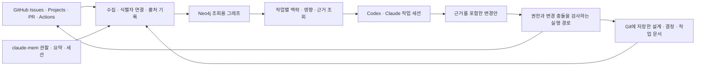

# GitHub 작업 관계와 claude-mem을 연결하는 그래프 활용 연구

조사일: 2026-11-15 KST. 유형: 연구. 최종 결정은 [도입 보류 ADR](../architecture/adr/0001-defer-graph-memory.md), 검토 과정은 [작업 #23](../tasks/23-graph-memory-review.md)에 기록한다.
요청: 설계에서 생성한 이슈·Project·문서의 관계를 작업 중 조회·갱신하고, claude-mem과 결합할 방법을 연구한다.

**판단: 현재 근거로는 새 그래프 DB를 추가하지 않는다. GitHub·작업 파일·claude-mem의 기존 절차를 유지한다. 관계 조회 계층은 9절의 재검토 조건이 충족될 때 비교할 후보로 남긴다.**
기대하는 가치는 **결정 변경의 영향 추적, 필요한 근거만 담은 세션 재개, 완료 주장과 실제 검증의 대조**다. 그러나 이를 뒷받침할 결정·검증 관계 데이터와 기존 절차의 실패 사례는 이번에 수집하지 않았다.
다만 그래프 DB 자체가 새로운 기술은 아니다. 아래의 효과는 이 환경에서 검증할 가설이며, 생산성 향상이나 비용 절감이 입증된 것은 아니다.

## 1. 현재 환경에서 확인한 근거

각 수치는 조사 중 개별 조회한 표본이다. 여러 시스템을 같은 순간에 고정한 스냅샷은 아니다.
[측정값과 의존 관계 원본](evidence/graph-workflow-2026-11-15.json)에 재계산 가능한 목록을 남겼다. 메모리 원문과 인증값은 포함하지 않았다.

| ID | 직접 확인한 사실 | 설계에 주는 의미 |
|---|---|---|
| F1 | 이 저장소는 결정은 docs, 실행은 Issues, 상태는 Projects, 통합은 PR로 구분한다. `docs/WORKFLOW.md:65` | 그래프는 기존 역할을 연결하는 보조 인덱스로 둔다. |
| F2 | 초기 조사에서 중앙 Project #20은 개인 소유이고 항목은 6개였다. 이슈 #21은 Closed, 해당 Project 상태는 Done, PR #22는 병합 상태였다. | 개인 Project의 API·권한·동기화 방식을 고려해야 한다. |
| F3 | 초기 조사에서 로컬 HEAD와 main CI 실행의 SHA는 `e2e8e589e8e63c5b918f05c47b39c695a4d90355`이며 CI는 success였다. 당시 STATE는 최종 결과 확인 후 다음 요청을 기다리라고 지시했다. | 기존 재개 절차의 SHA 대조로 확인되는 예상된 시점 차이다. 그래프 도입의 필요성을 증명하지 않는다. |
| F4 | 초기 조사에서 gon-stock03 Project #25와 열린 이슈는 각각 24개였다. GitHub API에서 명시적 차단 관계 52개를 조회했다. 페이지 누락은 없었다. | 관계 순회는 가능하다. 당시의 수량 일치만으로 두 집합의 동일성을 증명하지는 않는다. |
| F5 | claude-mem은 worker 모드다. 실행 중 HTTP API 버전은 `15.18.3`, 세션에 제공된 플러그인 캐시는 `15.15.0`이다. | 캐시 디렉터리명만으로 실제 동작 버전을 판단하면 안 된다. |
| F6 | 읽기 전용 SQLite 조사에서 관찰·세션·요약·파일 관계·작업 상태 테이블을 확인했다. 스키마 버전은 75다. | 과거 판단과 작업 대상을 연결할 재료가 이미 있다. |
| F7 | 조회 당시 이 프로젝트의 전체 관찰 236개 중 `title+narrative+facts`에 이슈/PR 전체 URL이 있는 기록은 0개, `#숫자`가 있는 기록은 50개다. 파일 목록이 있는 기록은 100개다. | 관찰 필드의 식별자 품질 조사다. 작업 파일·이슈 댓글의 품질이나 기존 절차의 실패를 측정하지 않았다. |
| F8 | `GET /api/observations?project=gon-github-workflow&limit=1&offset=0` 한 번에서 `items/hasMore/offset/limit`를 받았다. 공식 예시의 `observations/total`과 다르다. | 수집 어댑터를 만들 경우 실행 버전과 응답을 검증해야 한다. 전체 API 호환성 검사는 아니다. |

F2–F3 근거: [Project #20](https://github.com/users/krdn/projects/20), [이슈 #21](https://github.com/krdn/gon-github-workflow/issues/21), [PR #22](https://github.com/krdn/gon-github-workflow/pull/22), [main CI](https://github.com/krdn/gon-github-workflow/actions/runs/43663487594), [조사 당시 STATE](https://github.com/krdn/gon-github-workflow/blob/e2e8e589e8e63c5b918f05c47b39c695a4d90355/docs/STATE.md).
F4 근거: [Project #25](https://github.com/users/krdn/projects/25), [기준선 #5](https://github.com/krdn/gon-stock03/issues/5), [공통 상태 계약 #6](https://github.com/krdn/gon-stock03/issues/6).
F5–F8은 로컬 `GET /api/health`, `GET /api/version`, 프로젝트 한정 관찰 API, SQLite `mode=ro` 질의 결과다.
F7은 지정한 필드의 정규식 조사다. 일반 GitHub URL은 1개 관찰에서 발견됐지만 이슈/PR URL은 아니었다.
`#숫자`에는 Project·PR·관찰 번호도 들어가므로 50건을 이슈 연결률로 해석할 수 없다.
요약·원시 도구 기록·metadata까지 링크가 없다는 뜻도 아니다. 원문과 관찰 ID 목록은 보관하지 않아 당시 집계를 완전히 재현할 수는 없다.
초기 개별 조회의 정확한 시각은 기록하지 않았으며, 자동 관찰이 추가되므로 현재 기록 수와는 다를 수 있다.

**최종 검토 중 재조회:** 2026-11-15 02:07:23–24 UTC에 두 저장소가 모두 PUBLIC임을 확인했다.
당시 Project #25는 24개 항목, 열린 이슈는 23개였다. 차이는 01:59:08 UTC에 종료된 #5이며, 관계 수는 52개로 유지됐다.
이는 초기 스냅샷의 오류가 아니라 조사 이후의 상태 변경이다. 관계가 남아 있다는 사실과 현재 착수 차단 여부를 구분해야 한다.

**작은 실증:** API의 `blockedBy`를 `선행 → 후속` 방향으로 바꾸고 메모리 안에서 중복을 제거하며 순회했다.

| 시작 이슈 | 직접 후속 관계 | 간접 관계를 포함한 후속 이슈 수 |
|---|---|---:|
| gon-stock03 #5 기준선 | #6, #23, #24 | 20 |
| gon-stock03 #6 공통 상태 계약 | #7, #8, #9, #10, #15, #16, #17 | 17 |

52개 관계에서 순환은 발견하지 않았다. 이 계산은 **관계상 영향 후보**를 찾는다. 현재의 미완료 선행 조건은 각 이슈 상태와 수용 근거를 별도로 확인해야 한다.
후속 후보가 대부분의 작업에 해당하므로, 이 계산만으로 정밀한 변경 영향 분석을 했다고 볼 수 없다. 실제 지연 시간·작업량·최적 일정은 계산하지 않았다.
Neo4j나 Graphiti를 실행한 결과도 아니다. 같은 계산은 일반 코드나 SQL로 가능하다.

## 2. 기존 기능과 새로 필요한 부분

**GitHub는 이미 기본 업무 그래프를 제공한다.** 하위 이슈와 차단 의존성을 API로 읽고 변경할 수 있다.
따라서 `BLOCKS` 관계를 LLM으로 본문에서 다시 추측할 이유가 없다. 명시적 API 관계를 먼저 복사한다.
Project의 필드와 상태는 GraphQL로 조회·갱신한다. [의존성 API](https://docs.github.com/en/rest/issues/issue-dependencies), [하위 이슈 API](https://docs.github.com/en/rest/issues/sub-issues), [Projects API](https://docs.github.com/en/issues/planning-and-tracking-with-projects/automating-your-project/using-the-api-to-manage-projects).

**claude-mem은 이미 경험 검색과 주제별 질의 기능을 제공한다.** SQLite/FTS5와 선택적인 Chroma 검색 계층을 사용한다.
Smart Search는 검색 목록 → 주변 시간대 → 선택한 관찰 상세의 순서다. Knowledge Agent는 관찰을 모은 corpus를 세션에 넣어 질문한다.
새 관찰을 반영하려면 corpus를 rebuild하고 reprime해야 한다. 이것만으로 GitHub 상태가 계속 동기화되거나 명시적인 의존 관계 질의가 생기는 것은 아니다.
[검색 구조](https://docs.claude-mem.ai/architecture/search-architecture), [Knowledge Agents](https://docs.claude-mem.ai/usage/knowledge-agents).

| 질문 | 우선 사용할 자료·방식 | 그래프가 더하는 가치 |
|---|---|---|
| “지난번 이 오류를 어떻게 해결했나?” | claude-mem 검색 | 관련 이슈·커밋으로 이동 |
| “현재 이슈가 열려 있나?” | GitHub 직접 조회 | 거의 없음 |
| “이 결정이 바뀌면 어느 작업과 검증을 다시 봐야 하나?” | 결정·문서·업무·검증의 연결 | 여러 자료를 가로지르는 경로 추적 |
| “새 세션에서 무엇만 읽으면 되나?” | 작업 문서 + 현재 상태 + 관련 경험 | 필요한 관계 범위로 읽을 자료 축소 |
| “완료됐다고 기억하는데 현재 근거도 충분한가?” | 과거 주장과 해당 SHA의 CI·수용 기록 | 주장과 검증의 분리·대조 |

## 3. 재검토 시 비교할 구성

아래는 **필요성이 확인된 뒤 비교할 가설**이다. 현재의 도입 권고나 구현 계획이 아니다.
여기서 노드는 이슈·결정 같은 대상, 관계는 두 대상의 연결, projection은 원본에서 재생성할 수 있는 조회용 복사본을 뜻한다.
GraphRAG는 검색한 그래프 정보를 AI 답변의 근거로 사용하는 방식이다. Graphiti는 시간 정보를 가진 그래프를 구성하는 라이브러리다.



GitHub의 상태와 Git 문서의 확정 결정을 기준으로 삼는다. claude-mem은 “당시에 무엇을 관찰하고 판단했는지”를 보존한다.
그래프의 수집 결과는 재생성할 수 있게 한다. 수동 확정 연결과 추출 규칙은 그래프 외부의 버전 관리 원본에 보존한다. 구체 저장 위치는 구현 검토 시 정한다.
그래프가 멈추면 기존 `STATE → 작업 파일 → 관련 원격 상태` 절차로 재개한다. 그래프 장애가 개발을 막지 않게 한다.

### 최소 데이터 모델

| 대상 | 핵심 연결 | 주의점 |
|---|---|---|
| Repository, Project, ProjectItem | `Project → HAS_ITEM → ProjectItem → CONTENT → Issue/PR` | 같은 이슈가 여러 Project에서 다른 상태를 가질 수 있다. Status를 Issue에 하나만 저장하지 않는다. DraftIssue도 구분한다. |
| Issue | `PARENT_OF`, `BLOCKS` | `BLOCKS`는 선행 → 후속으로 통일한다. 본문 링크는 별도 `REFERENCES`다. |
| PullRequest, Commit, CheckRun | PR의 변경 SHA, merge SHA, 실행의 SHA | 다른 SHA의 CI 성공을 현재 작업의 검증으로 쓰지 않는다. |
| DocumentRevision, Decision | 문서 버전이 결정을 기록하고 결정이 작업에 적용됨 | 문서 경로뿐 아니라 commit SHA와 위치를 기록한다. |
| Observation, Session | `RECORDED_IN`, `MENTIONS` | 관찰이 이슈를 언급한다고 검증·승인을 증명하지 않는다. |
| Claim, Evidence | `SUPPORTED_BY`, `SUPERSEDES`, `CONTRADICTS` | 처음에는 필요한 결정·검증 주장에만 추가한다. LLM이 만든 충돌은 확인 후보다. |

공통 출처 필드에는 `source_uri`, `source_revision`, `observed_at`, `content_hash`, `extraction_method`를 둔다.
변할 수 있는 사실에는 실제 유효 기간과 시스템이 그 사실을 알게 된 시간을 나눠 기록한다. 실제 발생 시간이 불명확하면 미상으로 남긴다.
추출 상태는 `explicit / inferred / reviewed`로 구분한다. 모델의 confidence 값을 검증된 확률처럼 취급하지 않는다.

GitHub 항목은 node ID를 우선 식별자로 사용하고 저장소·번호·URL을 함께 보존한다. 번호 `#20`만으로 합치지 않는다.
claude-mem 관찰은 로컬 ID에 설치 인스턴스 식별자를 붙인다. 동기화된 데이터의 origin 식별자도 이용할 수 있는지 확인한다.
프로젝트명만 같은 다른 저장소, rename·transfer된 이슈, 두 기기의 관찰 ID 충돌을 처리해야 한다.

## 4. claude-mem을 활용하는 현실적인 연결 방법

**연결 필요성이 입증되면 claude-mem의 저장 구조를 바꾸지 않고 외부 어댑터를 비교한다.** 그때 검토할 단계는 다음과 같다.

1. API로 프로젝트별 관찰·요약을 읽고 원본 ID와 해시를 보존한다. 상세 본문은 필요할 때 다시 조회한다.
2. 전체 URL·정확한 저장소/이슈 번호·커밋 SHA·작업 파일을 이용해 확정 연결을 만든다.
3. 불명확한 과거 기록은 파일·세션·날짜·내용으로 후보를 만들고 확인 전에는 `inferred`로 유지한다.

예를 들어 관찰 #36416의 “Infisical PR #20 병합”은 중앙 저장소의 PR #20과 연결할 후보다.
관찰에 기록된 SHA와 실제 PR을 대조한 뒤 확정한다. 해당 관찰의 “실제 서비스 연결은 미수행”도 함께 보존한다.
그러면 나중에 “Infisical 연결됐나?”라는 질문에서 템플릿 배포와 실제 서비스 접속을 구분할 수 있다.
이번에는 관찰 #36415·#36416을 검색 → timeline → 상세 조회로 확인했다. 실제 서비스 연결을 새로 검증한 것은 아니다.

작업 파일의 기존 이슈/PR·마지막 확인 SHA·검사 대상 SHA 항목에 전체 URL과 전체 SHA를 적는 현재 양식을 유지한다.
관련 항목은 `templates/docs/tasks/TEMPLATE.md:12`와 `templates/docs/tasks/TEMPLATE.md:23`에 있다. 이것이 관찰의 링크율을 높이는지는 확인하지 않았다.
어댑터의 연결 레코드가 재분석 비용을 줄이는지도 후속 실험의 대상이다.
아래 형식은 새 어댑터의 제안이다. claude-mem MCP가 이 metadata 형식을 이미 지원한다는 뜻은 아니다.

```json
{
  "observation_key": "cmem:<instance>:36416",
  "repository": "krdn/gon-github-workflow",
  "issue_url": "https://github.com/krdn/gon-github-workflow/issues/19",
  "pull_request_url": "https://github.com/krdn/gon-github-workflow/pull/20",
  "relation_status": "inferred",
  "basis": "관찰의 저장소 맥락과 명시된 PR 번호; 원격 대조 전"
}
```

대량 초기 수집에는 공식 export 방식도 후보지만, 검색 결과 몇 건을 전체 메모리로 간주하면 안 된다.
프로젝트 필터·페이지 완전성·내보내기 범위를 확인해야 한다. 공식 export는 원문을 포함하므로 공개 저장소에 통째로 넣지 않는다.
[Worker 조회 API](https://docs.claude-mem.ai/architecture/worker-service), [Export/Import](https://docs.claude-mem.ai/usage/export-import).

현재 F8처럼 응답 형태가 문서와 다를 수 있다. 버전과 응답 키를 확인하고, 지원하지 않는 형태에서는 동기화를 중단한다.
관찰에는 생성 시각만으로 잡히지 않는 수정·병합·삭제가 있을 수 있다. 증가 ID만 따라가는 방식은 충분하지 않다.
해시 대조와 정기적인 전체 ID 대조를 병행한다. 내부 SQLite에 외부 테이블·트리거를 추가하지 않는다.

## 5. 작업 중 참고·갱신하는 흐름

| 시점 | 수행할 동작 | 반환할 결과 |
|---|---|---|
| 설계·분할 | 문서의 결정과 GitHub 하위 이슈·의존 관계를 수집 | 작업 범위, 근거, 선행 작업, 빠진 연결 후보 |
| 세션 시작 | 대상 이슈의 현재 상태를 재조회하고 관련 경로만 탐색 | 목표·필수 문서·미완료 조건·관련 실패 경험과 출처 |
| 구현 중 | 바뀐 파일·계약에 연결된 결정과 후속 작업 조회 | 영향을 받을 작업과 재검증할 근거 후보 |
| 결정 변경 | 기존 결정을 삭제하지 않고 새 결정과 대체 관계 기록 | 변경 이유, 영향 범위, 갱신할 문서·이슈 초안 |
| 완료 전 | 해당 SHA의 PR·CI와 명시적 수용 기록을 확인 | 확인됨·미확인·해당 없음이 분리된 근거 목록 |
| 인수인계 | 확인한 근거를 바탕으로 task/STATE 수정안 생성 | 짧은 재개 문서와 고정 링크 |

조회 API 후보는 `task_context(issue)`, `impact_of_change(target)`, `explain_blockers(issue)`, `completion_evidence(issue)`다.
이름은 인터페이스 예시이며 현재 제공되는 명령이 아니다. 처음에는 이 네 가지처럼 제한된 조회를 제공한다.
한 번에 그래프 전체를 프롬프트에 넣지 않는다. 관계 깊이·반환 항목·본문 길이를 제한하고 필요한 상세만 뒤에 읽는다.

갱신은 `변경안 → 원본 재조회 → 충돌 검사 → 원본 변경 → 결과 재조회 → 그래프 반영` 순서다.
실행 범위는 사용자가 미리 정한 권한 정책을 따른다. 그래프의 추론만으로 완료·수용 상태를 올리지 않는다.
원본 수정과 그래프 반영을 하나의 원자적 트랜잭션으로 묶을 수는 없다. 실패한 단계를 기록하고 재조회 후 재시도한다.
`updatedAt` 사전 비교도 모든 GitHub 변경을 원자적으로 잠그지는 않는다. 대상별 직렬화와 사후 충돌 확인이 필요하다.

### 동기화에서 빠뜨리면 안 되는 조건

- **개인 Project:** 현재 #20·#25는 사용자 소유다. 공식 `projects_v2_item` webhook은 조직 Project 대상으로 문서화돼 있다. 세션 시작·종료의 API 재조회와 주기적 대조를 기본으로 둔다. [공식 이벤트 범위](https://docs.github.com/en/webhooks/webhook-events-and-payloads#projects_v2_item).
- **누락·역순·중복:** webhook은 변경 알림으로 쓰고 최신 항목을 다시 읽는다. GitHub는 실패한 webhook을 자동 재전송하지 않는다. delivery ID 중복 제거·재시도·전체 대조가 필요하다. [실패한 전달 처리](https://docs.github.com/en/webhooks/using-webhooks/handling-failed-webhook-deliveries).
- **삭제·권한 변경:** 404를 곧바로 삭제로 해석하지 않는다. 권한 상실과 삭제를 구분하고, 접근할 수 없어진 자료는 조회 대상에서 제외한다. 원본 삭제 정책을 그래프·임베딩·백업에도 적용한다.
- **불완전 수집:** pagination, rate limit, 실패한 저장소를 표시한다. `observed_at`과 수집 상태를 결과에 붙이고 누락된 상태를 “관계 없음”으로 바꾸지 않는다.
- **자기 증폭:** 그래프 답변이 다시 claude-mem에 저장돼도 독립된 새 근거로 세지 않는다. 최초 source ID·파생 경로를 보존해야 한다. 현재 자동 관찰에서 이 연결을 집행할 수 있는지는 미검증이다. 구현 검토에서는 파생 세션을 식별·제외할 수 있는지 먼저 시험한다.

## 6. 가치가 있을 것으로 예상하는 활용법

아래는 **현재 개발 방식에 도움이 될 가능성**을 분류한 것이다. 기존 절차보다 개선됐다고 입증된 항목은 없다.

| 우선순위 | 활용법 | 구체적인 결과 | 검증할 가설 |
|---|---|---|---|
| 1 | 필요한 근거만 모으는 세션 재개 | 이슈 하나로 필수 문서, 최신 선행 상태, 유효한 결정, 관련 실패 기록을 묶는다. | 전체 이력을 다시 읽는 시간과 입력 토큰이 줄어든다. |
| 1 | 결정 변경의 영향 추적 | “이 전제가 바뀌었다”에서 연결된 작업·문서·검증을 역추적한다. | 빠뜨린 후속 수정과 낡은 전제 사용이 줄어든다. |
| 1 | 완료 근거 대조 | Issue Closed, Project Done, PR merge, 해당 SHA CI, 사용자 수용을 따로 보여준다. | “기억에는 완료”인 상태의 잘못된 후속 진행을 줄인다. |
| 2 | 변경 가정에 따른 작업 재배치 | #5 또는 #6의 변경 시 영향 후보와 새로 실행 가능한 작업을 계산한다. | 수동 의존성 확인을 줄인다. 일정 예측에는 별도 작업량·자원 정보가 필요하다. |
| 2 | 실패 경험의 조건부 재사용 | 같은 파일·도구·버전·오류 조건에서 과거 실패와 해결 근거를 먼저 제시한다. | 단순 키워드 유사성보다 재발 방지 정확도가 높다. |

가장 유망한 결합은 **“무엇을 해야 하는가”와 “왜 그렇게 결정했는가”, “무엇으로 확인했는가”를 함께 조회하는 것**이다.
예를 들어 공통 상태 계약 #6의 변경 요청이 오면 17개 후속 후보에서 실제 계약 사용처를 좁히는 기능을 생각할 수 있다.
그러나 이를 위한 계약 사용처·결정·검증 연결은 이번에 수집하지 않았다. 현재 자료로는 17개 후보 목록까지만 계산할 수 있다.

F3의 시점 차이는 기존 재개 절차로도 확인된다. PR 안의 STATE가 자기 병합 결과를 미리 기록할 수는 없으므로 이를 절차의 결함으로 보지 않는다.
과거 관찰은 당시에는 맞았을 수 있으므로 덮어쓰지 않는다. 최신 상태와 과거 상태를 나눠 보여준다.

## 7. 도구 선택

제품 기능은 공식 자료로 확인했다. 아래 적합도·운영 부담은 이 사용 사례에 대한 종합 판단이며 성능 벤치마크가 아니다.

| 선택지 | 강점 | 추가 부담·한계 | 권고 |
|---|---|---|---|
| GitHub + claude-mem만 활용 | 기존 기능 재사용, 새 DB 불필요 | 여러 자료를 가로지르는 관계 탐색을 매번 수행 | 비교 기준으로 유지 |
| 별도 SQLite 관계 테이블 | 작은 데이터의 관계 계산, 낮은 운영 부담 | 관계 종류·시점·탐색 UI가 늘면 직접 구현할 부분 증가 | 재검토 시 먼저 비교할 기준 |
| Neo4j + 명시적 API 관계 | Cypher 경로 질의, 관계 확장, 그래프 탐색 | 수집·식별자·동기화는 직접 필요 | API 직접 조회·스크립트·SQLite가 부족하다고 측정된 뒤의 후보 |
| Neo4j + Graphiti | 비정형 관찰의 엔티티·관계 추출, 시간별 사실, 증분 갱신 | LLM·embedding 비용과 오연결 검토, 별도 서비스 운영 | 기억 해석의 병목과 추가 효과가 확인될 때의 후보 |
| Microsoft GraphRAG | 문서 집합의 전반적인 주제·공동체 요약 | 추출·요약 인덱싱이 필요하고 업무 동기화는 별도 | 대규모 회고·조직 지식 분석 후보 |
| Neo4j Agent Memory | 대화·엔티티·애플리케이션 실행 기록 연결 | claude-mem과 수집 기능이 겹침; Labs 지원 범위 | 대체 필요성이 생길 때 비교 |

SQLite는 recursive CTE로 그래프를 조회할 수 있다. 현재 24개 이슈·52개 관계만으로 Neo4j가 필요하다고 결론 내릴 수는 없다.
관계가 여러 프로젝트의 결정·문서·검증까지 확장될 때 Neo4j의 편익을 측정한다. [SQLite 그래프 조회](https://sqlite.org/lang_with.html).

Neo4j의 `VectorCypherRetriever`는 의미 검색 결과에서 관계를 추가 탐색한다.
초기에는 claude-mem 검색이 반환한 observation ID를 그래프의 시작점으로 써도 된다. 동일 내용을 다시 embedding하는 것은 선택 사항이다.
공식 Neo4j MCP에는 읽기 전용 모드가 있다. 초기 조회에는 이를 사용하거나 제한된 질의 도구를 제공한다.
[Neo4j GraphRAG](https://neo4j.com/docs/neo4j-graphrag-python/current/user_guide_rag.html#vector-cypher-retriever), [Neo4j MCP 도구](https://neo4j.com/docs/mcp/current/tools/).

Graphiti는 시간별 사실·출처 episode·증분 수집·혼합 검색을 제공하며 Neo4j 등 별도 그래프 저장소를 사용한다.
DB, LLM, embedder와 수집·권한·운영은 별도로 구성해야 한다. 자동 모순 처리 결과가 실제 업무 사실의 진위를 보장하지는 않는다.
따라서 GitHub의 확정 관계를 Graphiti 추출 결과가 덮어쓰지 않도록 역할을 분리한다. [Graphiti 공식 저장소](https://github.com/getzep/graphiti).

Microsoft GraphRAG의 공동체 요약·전역 검색은 “전체 프로젝트에서 반복된 설계 문제는 무엇인가”에 적합한 후보다.
실시간 작업 상태 관리가 주목적이면 첫 도입 범위가 커진다. [Microsoft GraphRAG](https://microsoft.github.io/graphrag/), [인덱싱 흐름](https://microsoft.github.io/graphrag/index/default_dataflow/).
Neo4j Agent Memory는 공식 Labs 문서상 유지보수되지만 공식 지원·하위 호환 보장은 없다. 기존 claude-mem을 바로 옮길 근거는 부족하다.
[Neo4j Agent Memory](https://neo4j.com/labs/agent-memory/).

## 8. 운영 비용과 경계

**큰 비용 항목은 노드 저장보다 수집 신뢰성·식별자 연결·잘못된 추론의 정정이다.**
명시적 GitHub 관계 수집에는 LLM을 쓰지 않는다. 자연어 결정 추출은 변경된 내용만 처리하고 content hash로 중복을 피한다.
비용은 `호스팅 + 변경 건수 × 추출/embedding 비용 + 질의 비용 + 운영 시간`으로 측정한다.
실제 월비용·처리량·토큰 절감률은 이번 연구에서 측정하지 않았다. 업체의 검색 속도나 대화 벤치마크 수치를 이 워크플로의 성능으로 옮기지 않는다.

비밀 접근은 기존 [Infisical 운영 지침](../INFISICAL.md)을 따른다. 그래프에는 비밀값 대신 승인된 식별자·근거만 저장한다.
개인 작업 맥락과 공개 GitHub 자료를 합쳤다고 전체 그래프가 공개 가능한 것은 아니다.
외부 LLM·embedding 공급자를 선택하면 관찰 본문이 그 제공자로 전송될 수 있다. 전송 범위·보존 정책·권한을 도입 검토에 포함한다.
본문·관찰은 명령이 아닌 자료로 취급한다. 쓰기 권한은 조회 도구와 분리하고, 외부 문장만으로 실행 권한을 바꾸지 않는다.
여러 사용자가 쓰게 되면 DB 제품의 권한 기능과 조회 계층의 범위 검사를 별도로 확인한다. `project` 속성은 접근 통제 자체가 아니다.

## 9. 도입 판단을 위한 작은 비교 실험

후속 구현을 요청할 경우의 검증 제안이다. 이번 연구에서 설치·상시 수집·원격 갱신은 시작하지 않았다.

**진입 조건:** 기존 재개 절차와 native API 조회를 따랐는데도 누락·오판 또는 과도한 수집 비용이 실제 작업 기록으로 남은 경우에만 검토를 재개한다.
먼저 그 문제에 필요한 결정·이슈·검증 관계를 명시적으로 수집할 수 있는지 확인한다. 관계가 있다는 사실만으로 도입하지 않는다.
**중단 조건:** 같은 질문에서 API 직접 조회+짧은 스크립트 또는 SQLite가 동등하면 Neo4j 단계로 가지 않는다.
비교 전에 사용자와 오류·시간·비용의 허용 범위를 정한다. 기준을 정하지 않았다면 결과를 도입 승인으로 해석하지 않는다.

| 단계 | 범위 | 다음 단계로 갈 조건 |
|---|---|---|
| A | 기록된 문제의 관련 관계·문서 링크만 읽기 전용 수집 | 진입 조건 충족, 원본과 항목·관계 식별자 집합 일치, 재수집 중복 없음, 접근 불가 표시 |
| B | claude-mem 선택 관찰 연결, 위 네 가지 조회를 제공 | 확정 연결과 추론 연결 분리, 모든 답변에 근거와 조회 시점 |
| C | 인수인계·이슈·Project 변경안을 생성 | 원본 변동 시 충돌 검출, 실패 재시도에서 중복 변경 방지 |
| D | Graphiti로 자연어 결정·대체 관계 추출 | 수동 정답과 비교하고 사전에 정한 오류·비용 기준을 모두 충족 |

실제 작업에서 발생한 질문과 정답 근거를 사용자가 확인한 뒤 고정한다. 최초 20문항은 단일 상태·다단계 영향·과거 결정·완료 검증을 살펴보는 예비 평가다.
같은 모델·자료 시점·도구 권한에서 기존 STATE·작업 파일 재개 절차와 native 의존성 API 직접 조회를 기준선으로 삼는다.
먼저 짧은 스크립트·SQLite를 비교한다. 그 한계가 측정됐을 때 명시적 관계 그래프, 이후 추출된 기억의 추가 효과를 분리해 평가한다.
질문·채점표·실행 순서·반복 횟수를 비교 전에 고정한다. 20문항에서 한 문항은 5%p이므로 작은 유형별 표본의 비율만으로 개선을 판정하지 않는다.

| 지표 | 제안하는 합격 기준 |
|---|---|
| 근거 정확성 | 잘못된 완료·수용 판정 0건, 인용 근거로 확인 가능한 답변 |
| 데이터 정합성 | 동일 입력 재처리 중복 0건, 삭제·권한 상실·재개방·PR 새 SHA 사례 처리 |
| 관계 품질 | 명시적 관계의 재현율 100%; 확인하지 않은 추론을 확정 관계로 승격한 사례 0건 |
| 실용 효과 | 방식별 오답 수·수집 시간·입력 토큰을 함께 보고한다. 비율 기준은 문항 수와 기준선 측정 뒤에 정한다. |
| 운영 부담 | 수집·동기화·추출 비용, 정정 시간, 지연을 포함한다. 사전에 정한 전체 비용 한도를 넘으면 도입하지 않는다. |

초안의 30%·10%p 기준은 기준선과 표본 근거가 없어 철회했다. 20문항은 초기 선별용이며 통계적 일반화를 보장하지 않는다.
읽기 전용 단계를 통과해도 원격 자동 갱신의 안정성이 증명된 것은 아니다. 역순 이벤트·API 실패·동시 편집은 따로 시험한다.

## 10. 최종 제안과 확인 범위

**기존 GitHub·작업 파일·claude-mem 절차를 유지하고 DB·템플릿·CLI는 변경하지 않는다. Neo4j와 Graphiti는 재검토 조건 충족 후 더 단순한 방식과 비교할 후보로 남긴다.**
F4·F6은 연결 가능한 자료의 존재를 보여주지만 기존 절차의 부족이나 새 DB의 이득을 입증하지는 않는다.
F7·F8은 식별자·호환성 관리 비용을 보여준다. 현재는 연구와 도입 보류 결정을 저장소에 확정하는 것으로 마친다.

확인한 범위는 공식 기능 문서, 조사 시점의 GitHub 상태·Project 필드·의존 관계, 로컬 메모리 스키마·API 응답, 관계 순회 계산이다.
현재 worker와 플러그인 캐시 버전의 차이는 확인했지만 업데이트 구성 자체는 변경하거나 진단하지 않았다.
Neo4j/Graphiti 실행, Knowledge Agent priming, 자동 동기화·쓰기, 성능·비용 개선, 운영 복구는 미검증이다.
이슈·Project·기존 업무 문서의 원격 수정, 서비스 설치, 기존 claude-mem 관찰·DB 스키마 수정은 수행하지 않았다.

문서의 상대 링크, 근거 JSON과 24개 이슈·52개 관계 집계, Markdown 코드 블록, `git diff --check`를 확인했다.
`evolve docs ste-lint`는 이 저장소에 `docs/conventions/ste100-writing.md`가 없어 실행하지 못했다. lint 통과로 간주하지 않는다.
